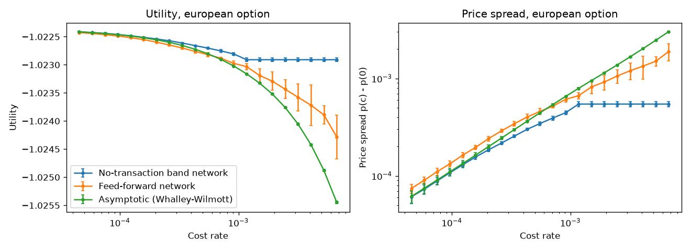
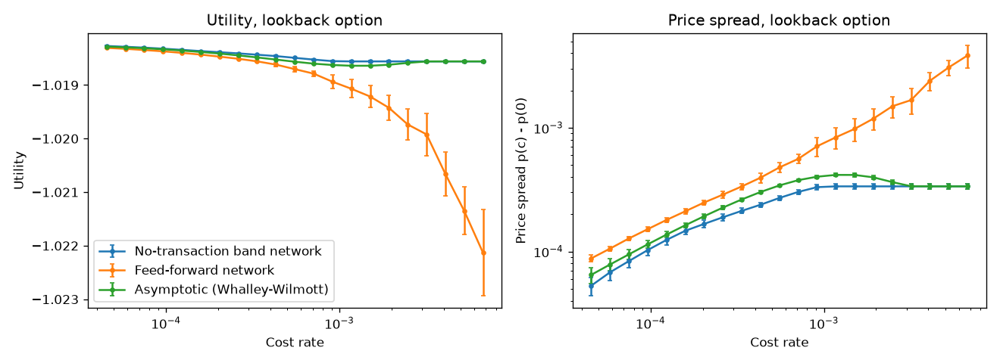
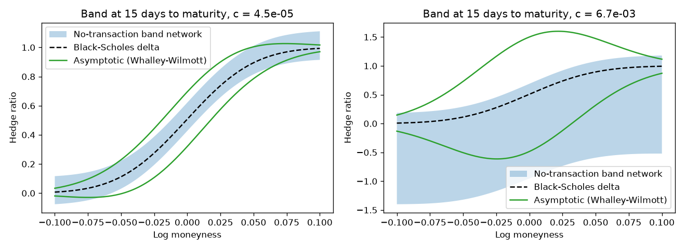
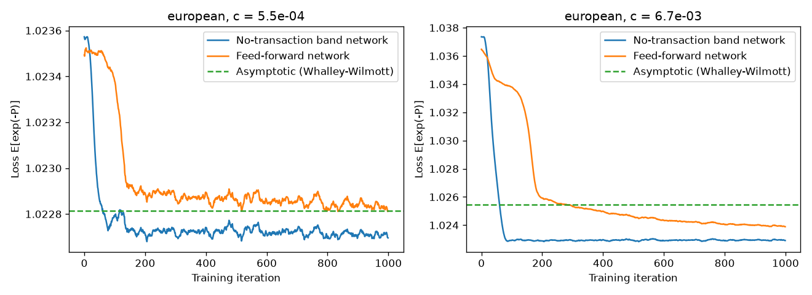
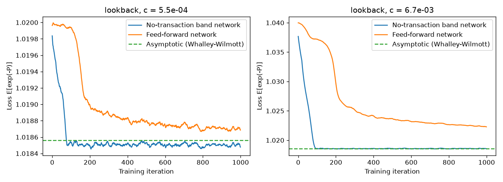

# deep-hedging

[](https://github.com/ladrerod/deep-hedging/actions/workflows/ci.yml)

Train, reproduce and serve the **No-Transaction Band Network** for hedging options under transaction costs, with one container image for Docker and Kubernetes.



## What it is

An independent re-implementation of Imaki, Imajo, Ito, Minami and Nakagawa,
[*No-Transaction Band Network: A Neural Network Architecture for Efficient Deep Hedging*](https://arxiv.org/abs/2103.01775) (2021):

- A small network outputs a band `[b_l, b_u]` around the Black-Scholes delta, and the hedger only trades when its position leaves the band. This avoids the "action dependence" that makes ordinary deep hedging slow to train.
- `deep-hedging sweep` trains the band network and a feed-forward deep hedger, and evaluates the Whalley-Wilmott asymptotic band, across the paper's 22 transaction costs (`--preset paper`; the default quick preset uses 6) for a European and a lookback call. It then regenerates the paper's figures and tables.
- `deep-hedging serve` exposes trained band networks over HTTP: the band, the next hedge and the indifference price for your option and cost.

Not affiliated with the authors or Preferred Networks. Research code, not investment advice.

## Quickstart: Docker

```sh
docker run -d --rm --name deep-hedging -p 127.0.0.1:8000:8000 ghcr.io/ladrerod/deep-hedging:0.1.0
curl -s --retry 20 --retry-delay 1 --retry-all-errors localhost:8000/v1/hedge -H 'content-type: application/json' \
  -d '{"derivative":"european","spot":100,"strike":100,"days_to_maturity":20,"volatility":0.2,"cost":0.0005,"current_hedge":0.3}'
docker stop deep-hedging   # when you are done
```

The image serves 44 pre-trained models (22 costs × 2 options). Interactive docs are at http://localhost:8000/docs.

To train your own (the quick preset takes about 1–2 minutes on 4 cores) and serve them:

```sh
mkdir -p out
docker run --rm -u "$(id -u):$(id -g)" -v "$PWD/out:/data" ghcr.io/ladrerod/deep-hedging:0.1.0 sweep --preset quick
docker run --rm -p 127.0.0.1:8000:8000 -v "$PWD/out:/data:ro" ghcr.io/ladrerod/deep-hedging:0.1.0 serve --models /data/quick/models
```

`out/quick/report/` then holds the figures and `tables.md`. On Linux, `-u` lets the non-root container write to your folder.

## Quickstart: Kubernetes

Any cluster works: OrbStack, kind, minikube, Docker Desktop or a cloud cluster.

```sh
kubectl apply -f https://raw.githubusercontent.com/ladrerod/deep-hedging/v0.1.0/k8s/api.yaml
kubectl rollout status deployment/deep-hedging
kubectl port-forward service/deep-hedging 8000:80 &
sleep 2
curl -s localhost:8000/v1/hedge -H 'content-type: application/json' \
  -d '{"derivative":"european","spot":100,"strike":100,"days_to_maturity":20,"volatility":0.2,"cost":0.0005}'
```

Train on the cluster, then serve what was trained:

```sh
git clone --depth 1 --branch v0.1.0 https://github.com/ladrerod/deep-hedging && cd deep-hedging
kubectl apply -f k8s/data.yaml -f k8s/sweep.yaml          # PVC + Job (quick preset)
kubectl wait --for=condition=complete job/deep-hedging-sweep --timeout=60m
kubectl logs job/deep-hedging-sweep | tail -40             # the results tables
kubectl apply -k k8s && kubectl rollout status deployment/deep-hedging
kubectl port-forward service/deep-hedging 8000:80 &        # restart: the old one ended with its pod
kubectl exec deploy/deep-hedging -- tar -C /data/quick -cf - report | tar -xf -   # copy the figures out
```

- **Re-run the Job:** `kubectl delete job deep-hedging-sweep && kubectl apply -f k8s/sweep.yaml`. Finished runs are skipped, and results stay on the PVC (`k8s/data.yaml`), so never delete that file's claim unless you mean it.
- **Back to the built-in models:** `kubectl apply -f k8s/api.yaml`.
- **Paper preset:** edit the two commented lines in `k8s/sweep.yaml` and the one in `k8s/kustomization.yaml`.
- **Storage:** every pod that mounts the ReadWriteOnce volume is pinned to its node by pod affinity. With a ReadWriteMany storage class you can drop the affinity blocks.
- **Locally built image:** build with `docker build -t ghcr.io/ladrerod/deep-hedging:0.1.0 .`. OrbStack and Docker Desktop see it directly; kind needs `kind load docker-image ghcr.io/ladrerod/deep-hedging:0.1.0`; minikube needs `minikube image load ghcr.io/ladrerod/deep-hedging:0.1.0`.

The API has no authentication, rate limiting or request-size cap: keep the Service cluster-internal, or put a gateway with auth, TLS, rate limits and a body-size limit in front of it before exposing it.

## API

| Endpoint | Returns |
|---|---|
| `GET /healthz` | `{"status": "ok", "models": 44}` |
| `GET /v1/models` | every model: derivative, cost, volatility, days, trained strike, preset, recorded price |
| `POST /v1/hedge` | `bs_delta`, `band.lower`, `band.upper`, `next_hedge`, `trade` (one forward pass) |
| `POST /v1/price` | `price`, `std_error` from 20,000 Monte Carlo paths with a control variate (~0.1–0.2 s); `503` with `Retry-After: 1` when 8 pricing requests are already queued |

**Request body:**

```json
{"derivative": "european", "spot": 101.5, "strike": 100, "days_to_maturity": 15,
 "volatility": 0.2, "cost": 0.0001, "current_hedge": 0.3}
```

- Lookback requests may add `max_spot`: the running maximum over daily closes including today (default `spot`).
- `price` is the indifference price of the remaining hedged liability, starting from `current_hedge`. For a new option (`current_hedge` 0) it is the paper's indifference price.

**Validity limits.** Requests outside these return 422 or 404 with the accepted range:

- **Volatility** must equal a trained one (0.2 for the built-in models).
- **Maturity:** `days_to_maturity` ≤ 28.
- **Moneyness:** spot within the range training simulated for that time. That is ±4σ√((elapsed days + 1)/365) around the training start (the strike for the European, strike/1.03 for the lookback), for example within about 4% of the strike (European) for a brand-new 28-day option.
- **Cost:** within half a grid step (log scale) of a trained cost. Cost 0 uses only the zero-cost model.

**Units.** Risk aversion λ = 1 applies to P&L per unit of `strike / K_train`, where `K_train` is 1 (European) or 1.03 (lookback). Equivalently `λ = K_train / strike`. With this low risk aversion the bands are wide, and above roughly 0.15% cost the European network learns not to hedge at all. That matches the paper, but it surprises people.

**Served models** are the best of 5 seeds, so their recorded prices are optimistic by about one standard error.

## Reproducing the paper

| Preset | Costs × seeds | Iterations × paths | Time (Apple M5 Pro, 4 workers) |
|---|---|---|---|
| `smoke` | 2 × 1 | 5 × 1,000 | seconds (tests and CI) |
| `quick` (default) | 6 × 1 | 300 × 10,000 | about 1–2 minutes |
| `paper` | 22 × 5 | 1,000 × 50,000 | about 7–8 hours |

- Run `uv run deep-hedging sweep --preset paper --workers 4`. It resumes if interrupted. Keep the machine awake and on mains power: on macOS, prefix the command with `caffeinate -is`.
- One training iteration at 50,000 paths takes about 0.17 s on one core. More than 4 workers did not help: the work is memory-bandwidth bound.

The figures and tables below come from the paper preset: [`docs/results/tables.md`](docs/results/tables.md) lists our prices next to the paper's Tables B2 and B4.

| | |
|---|---|
|  |  |
|  |  |

### Reproduction checks (paper preset)

- 5 seed(s), 21 positive costs.
- European: band network price <= feed-forward at every positive cost: yes.
- European: band network within 3 combined sd of Table B2 at costs <= 1e-3: 13/13.
- European: band network plateaus at the no-hedge price 0.02267 for c >= 1.5e-3: 7/7.
- Lookback: band network price <= feed-forward at every positive cost: yes.
- Share of the loss improvement reached by iteration 100 (European, c = e^-7.5, seed 0): band network 88%, feed-forward 19%.

### Deviations from the paper

- **28 daily steps, not 30.** The paper's tables only match 28: the zero-cost European price is 0.022101 with 28 steps (paper 0.022101) but 0.022880 with 30. The authors' code builds `int((30/365)/(1/365)) = 29` time points.
- **Exactly driftless paths.** The reference code's path generator has a drift of about -1.1e-4 over the horizon.
- **Closed-form lookback greeks** instead of automatic differentiation, which on current PyTorch returns a quarter of the gamma whenever the spot equals its running maximum.
- **Lookback prices are for daily monitoring.** The payoff and `max_spot` use daily closes, so served lookback prices sit below the continuous-monitoring Black–Scholes value (about 16% lower for a new 28-day, strike-1.03 option; the continuous value is about 19% higher). The continuous delta is still the band centre, as in the paper.
- **Not reproduced:** the appendix learning-rate study (Figure A1).
- **Not reproducible from the paper itself:**
  - Table B3 is a copy of Table B1.
  - The lookback "Asymptotic" column (for example 0.018731 at c = e^-7, where exact greeks give 0.018464 and the authors' own library gives 0.018445).
  - The European "Asymptotic" column at c ≥ e^-6, which matches only a one-day-shifted time-to-maturity input.
  - The lookback band-network prices at high cost, which exceed the price of not hedging (0.0191 vs 0.0184). Ours level off at the no-hedge price.
- **Learning curves** show the per-iteration training loss (20-iteration rolling mean) instead of 20 validation simulations per point.
- **Reproducible within Monte Carlo error,** not bit-for-bit across CPUs or PyTorch versions.

## Train your own model

With Docker (no Python needed):

```sh
mkdir -p out
docker run --rm -u "$(id -u):$(id -g)" -v "$PWD/out:/data" ghcr.io/ladrerod/deep-hedging:0.1.0 \
  train --derivative lookback --cost 0.001 --sigma 0.25 --days 21
docker run --rm -p 127.0.0.1:8000:8000 -v "$PWD/out:/data:ro" ghcr.io/ladrerod/deep-hedging:0.1.0 serve --models /data/custom/runs
```

From a clone, run `uv sync` once and prefix the commands with `uv run` (for example `uv run deep-hedging train --derivative lookback --cost 0.001`). A models directory may hold one horizon (`--days`) per derivative and volatility. Serve the result locally with `uv run deep-hedging serve --models out/custom/runs`.

## Development

```sh
uv sync && uv run pytest -q && uv run ruff check .
docker build -t ghcr.io/ladrerod/deep-hedging:0.1.0 .
```

- **Bundled models and figures:**
  ```sh
  uv run deep-hedging sweep --preset paper --workers 4
  find models -name '*.pt' -delete && cp out/paper/models/*.pt models/
  cp out/paper/report/* docs/results/
  ```
- **Release:**
  1. Bump `version` in `pyproject.toml` and the image tag in `k8s/api.yaml` and `k8s/sweep.yaml` (a test checks they agree).
  2. Commit, tag `vX.Y.Z` and push.
  3. CI publishes the multi-arch image to GHCR. After the first release, check that the package is public under GitHub → Packages.

## Limitations

One volatility (0.2), driftless geometric Brownian motion, European and lookback calls only, proportional costs, a fixed risk aversion, CPU only, one-node training on Kubernetes.

## Credits

The paper: Shota Imaki, Kentaro Imajo, Katsuya Ito, Kentaro Minami, Kei Nakagawa.

The authors' [`pfnet-research/NoTransactionBandNetwork`](https://github.com/pfnet-research/NoTransactionBandNetwork) and [`pfnet-research/pfhedge`](https://github.com/pfnet-research/pfhedge) (MIT, © 2021 pfnet-research) were consulted for conventions and test values. No code from them is included.

```bibtex
@article{imaki2021ntb,
  title   = {No-Transaction Band Network: A Neural Network Architecture for Efficient Deep Hedging},
  author  = {Imaki, Shota and Imajo, Kentaro and Ito, Katsuya and Minami, Kentaro and Nakagawa, Kei},
  journal = {arXiv preprint arXiv:2103.01775},
  year    = {2021}
}
```

License: MIT.
